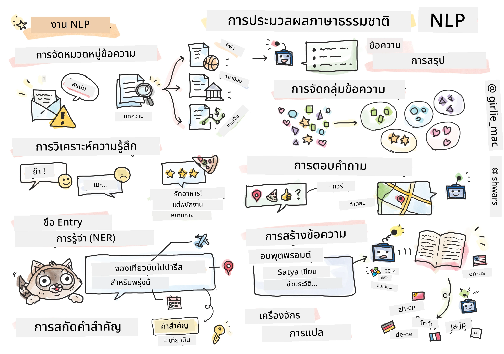

# การประมวลผลภาษาธรรมชาติ



ในส่วนนี้ เราจะมุ่งเน้นการใช้เครือข่ายประสาทเทียมเพื่อจัดการงานที่เกี่ยวข้องกับ **การประมวลผลภาษาธรรมชาติ (NLP)** มีปัญหา NLP หลายอย่างที่เราต้องการให้คอมพิวเตอร์สามารถแก้ไขได้:

* **การจำแนกข้อความ** เป็นปัญหาการจำแนกประเภทที่เกี่ยวข้องกับลำดับของข้อความ ตัวอย่างเช่น การจำแนกอีเมลว่าเป็นสแปมหรือไม่ใช่สแปม หรือการจัดหมวดหมู่บทความเป็นกีฬา ธุรกิจ การเมือง เป็นต้น และเมื่อพัฒนาบอทแชท เรามักต้องเข้าใจว่าผู้ใช้ต้องการจะสื่ออะไร -- ในกรณีนี้เรากำลังจัดการกับ **การจำแนกเจตนา** โดยปกติในการจำแนกเจตนา เราต้องจัดการกับหลายหมวดหมู่
* **การวิเคราะห์อารมณ์** เป็นปัญหาการถดถอย ซึ่งเราต้องกำหนดตัวเลข (อารมณ์) ที่สอดคล้องกับว่าความหมายของประโยคเป็นบวกหรือลบ เวอร์ชันที่ก้าวหน้ากว่าของการวิเคราะห์อารมณ์คือ **การวิเคราะห์อารมณ์แบบตามประเด็น** (ABSA) ซึ่งเราจะกำหนดอารมณ์ไม่ใช่ทั้งประโยค แต่แยกเป็นส่วนๆ (ประเด็น) เช่น *ในร้านอาหารนี้ ฉันชอบอาหาร แต่บรรยากาศแย่มาก*
* **การจดจำเอนทิตี้ชื่อ** (NER) หมายถึงปัญหาการดึงเอนทิตี้บางประเภทออกจากข้อความ เช่น เราอาจต้องเข้าใจว่าในวลี *ฉันต้องบินไปปารีสพรุ่งนี้* คำว่า *พรุ่งนี้* หมายถึง DATE และ *ปารีส* คือ LOCATION  
* **การดึงคีย์เวิร์ด** คล้ายกับ NER แต่เราต้องดึงคำที่สำคัญกับความหมายของประโยคโดยอัตโนมัติโดยไม่ต้องฝึกก่อนสำหรับประเภทเอนทิตี้เฉพาะ
* **การจัดกลุ่มข้อความ** สามารถมีประโยชน์เมื่อเราต้องการจัดกลุ่มประโยคที่คล้ายกัน เช่น คำขอที่คล้ายกันในการสนทนาการสนับสนุนทางเทคนิค
* **การตอบคำถาม** หมายถึงความสามารถของโมเดลที่จะตอบคำถามเฉพาะ โมเดลได้รับข้อความและคำถามเป็นอินพุต และต้องระบุตำแหน่งในข้อความซึ่งมีคำตอบสำหรับคำถาม (หรือบางครั้ง สร้างข้อความคำตอบ)
* **การสร้างข้อความ** คือความสามารถของโมเดลในการสร้างข้อความใหม่ สามารถพิจารณาเป็นงานจำแนกประเภทที่ทำนายอักษร/คำถัดไปโดยอิงจาก *ข้อความเริ่มต้น* โมเดลสร้างข้อความขั้นสูง เช่น GPT-3 สามารถแก้ไขงาน NLP อื่นๆ เช่น การจำแนกโดยใช้เทคนิคที่เรียกว่า [การเขียนคำสั่ง](https://towardsdatascience.com/software-3-0-how-prompting-will-change-the-rules-of-the-game-a982fbfe1e0) หรือ [การออกแบบคำสั่ง](https://medium.com/swlh/openai-gpt-3-and-prompt-engineering-dcdc2c5fcd29)
* **การสรุปข้อความ** เป็นเทคนิคที่เราต้องการให้คอมพิวเตอร์ "อ่าน" ข้อความยาวและสรุปในประโยคสั้นๆ
* **การแปลภาษาอัตโนมัติ** สามารถมองเป็นการผสมผสานระหว่างการเข้าใจข้อความในภาษาหนึ่ง และการสร้างข้อความในภาษาอีกภาษา

ในตอนแรก งานส่วนใหญ่ของ NLP ถูกแก้ไขโดยใช้วิธีการดั้งเดิม เช่น ไวยากรณ์ ตัวอย่างเช่น ในการแปล ภาษา เครื่องมือวิเคราะห์ไวยากรณ์ถูกใช้เพื่อแปลงประโยคเริ่มต้นเป็นต้นไม้ไวยากรณ์ จากนั้นดึงโครงสร้างความหมายระดับสูงเพื่อแทนความหมายของประโยค และจากความหมายนั้นและไวยากรณ์ของภาษาปลายทาง ผลลัพธ์ก็ถูกสร้างขึ้น ปัจจุบัน งาน NLP หลายอย่างถูกแก้ไขได้อย่างมีประสิทธิภาพมากขึ้นโดยใช้เครือข่ายประสาทเทียม

> วิธี NLP แบบดั้งเดิมหลายวิธีถูกใช้งานในไลบรารี Python ชื่อ [Natural Language Processing Toolkit (NLTK)](https://www.nltk.org) มีหนังสือดีมาก [NLTK Book](https://www.nltk.org/book/) ที่พร้อมใช้ออนไลน์ซึ่งครอบคลุมวิธีแก้ปัญหา NLP ต่างๆ ด้วย NLTK

ในหลักสูตรของเรา เราจะเน้นที่การใช้เครือข่ายประสาทเทียมสำหรับ NLP เป็นหลัก และจะใช้ NLTK เมื่อจำเป็น

เราได้เรียนรู้เกี่ยวกับการใช้เครือข่ายประสาทเทียมกับข้อมูลตารางและภาพ ความแตกต่างหลักระหว่างข้อมูลเหล่านั้นกับข้อความ คือ ข้อความเป็นลำดับที่มีความยาวไม่คงที่ ขณะที่ขนาดอินพุตสำหรับภาพรู้ล่วงหน้า ขณะที่เครือข่ายคอนโวลูชันสามารถดึงรูปแบบจากข้อมูลอินพุต รูปแบบในข้อความซับซ้อนกว่า เช่น เราอาจมีคำปฏิเสธที่ถูกแยกจากประธานโดยคำจำนวนไม่จำกัด (เช่น *ฉันไม่ชอบส้ม* กับ *ฉันไม่ชอบส้มที่ใหญ่ สีสันสดใสและอร่อย*) ซึ่งยังควรถูกตีความเป็นรูปแบบเดียว ดังนั้นเพื่อจัดการกับภาษา เราต้องแนะนำประเภทเครือข่ายประสาทใหม่ เช่น *เครือข่ายวนซ้ำ* และ *ทรานส์ฟอร์เมอร์*

## ติดตั้งไลบรารี

หากคุณใช้การติดตั้ง Python ในเครื่องเพื่อรันหลักสูตรนี้ คุณอาจต้องติดตั้งไลบรารีทั้งหมดที่จำเป็นสำหรับ NLP ด้วยคำสั่งต่อไปนี้:

**สำหรับ PyTorch**
```bash
pip install -r requirements-pytorch.txt
```
**สำหรับ TensorFlow**
```bash
pip install -r requirements-tf.txt
```

> คุณสามารถลองทำ NLP กับ TensorFlow ได้ที่ [Microsoft Learn](https://docs.microsoft.com/learn/modules/intro-natural-language-processing-tensorflow/?WT.mc_id=academic-77998-cacaste)

## คำเตือนเกี่ยวกับ GPU

ในส่วนนี้ ตัวอย่างบางส่วนเราจะฝึกโมเดลขนาดค่อนข้างใหญ่
* **ใช้คอมพิวเตอร์ที่รองรับ GPU**: แนะนำให้รันโน้ตบุ๊กบนคอมพิวเตอร์ที่มี GPU เพื่อช่วยลดเวลารอเมื่อทำงานกับโมเดลขนาดใหญ่
* **ข้อจำกัดหน่วยความจำ GPU**: การรันบน GPU อาจทำให้เกิดสถานการณ์ที่หน่วยความจำ GPU หมด โดยเฉพาะเมื่อต้องฝึกโมเดลขนาดใหญ่
* **การใช้หน่วยความจำ GPU**: ปริมาณหน่วยความจำ GPU ที่ใช้งานระหว่างฝึกขึ้นอยู่กับหลายปัจจัย รวมถึงขนาดมินิบัตช์
* **ลดขนาดมินิบัตช์**: หากพบปัญหาหน่วยความจำ GPU ควรพิจารณาลดขนาดมินิบัตช์ในโค้ดของคุณเป็นทางแก้ปัญหาที่เป็นไปได้
* **การปล่อยหน่วยความจำ GPU ใน TensorFlow**: เวอร์ชันเก่าของ TensorFlow อาจไม่ปล่อยหน่วยความจำ GPU อย่างถูกต้องเมื่อฝึกหลายโมเดลในเคอร์เนล Python เดียว เพื่อควบคุมการใช้หน่วยความจำ GPU อย่างมีประสิทธิภาพ คุณสามารถกำหนดค่า TensorFlow ให้จัดสรรหน่วยความจำ GPU เฉพาะเมื่อจำเป็น
* **การใส่โค้ด**: เพื่อกำหนดให้ TensorFlow จัดสรรหน่วยความจำ GPU เพิ่มเติมเฉพาะเมื่อจำเป็น ให้ใส่โค้ดต่อไปนี้ในโน้ตบุ๊กของคุณ:

```python
physical_devices = tf.config.list_physical_devices('GPU') 
if len(physical_devices)>0:
    tf.config.experimental.set_memory_growth(physical_devices[0], True) 
```

หากคุณสนใจเรียนรู้เกี่ยวกับ NLP จากมุมมองของ ML คลาสสิก เยี่ยมชม [ชุดบทเรียนนี้](https://github.com/microsoft/ML-For-Beginners/tree/main/6-NLP)

## ในส่วนนี้
ในส่วนนี้เราจะเรียนรู้เกี่ยวกับ:

* [การแทนข้อความเป็นเทนเซอร์](13-TextRep/README.md)
* [การฝังคำ](14-Embeddings/README.md)
* [การสร้างแบบจำลองภาษา](15-LanguageModeling/README.md)
* [เครือข่ายประสาทวนซ้ำ](16-RNN/README.md)
* [เครือข่ายสร้างสรรค์](17-GenerativeNetworks/README.md)
* [ทรานส์ฟอร์เมอร์](18-Transformers/README.md)

---

<!-- CO-OP TRANSLATOR DISCLAIMER START -->
**ปฏิเสธความรับผิดชอบ**:
เอกสารนี้ได้รับการแปลโดยใช้บริการแปลภาษา AI [Co-op Translator](https://github.com/Azure/co-op-translator) ขณะที่เราพยายามให้ความถูกต้อง โปรดทราบว่าการแปลโดยอัตโนมัติอาจมีข้อผิดพลาดหรือความไม่ถูกต้อง เอกสารต้นฉบับในภาษาต้นทางควรถูกพิจารณาเป็นแหล่งข้อมูลที่เชื่อถือได้ สำหรับข้อมูลที่สำคัญ แนะนำให้ใช้การแปลโดยมนุษย์มืออาชีพ เราไม่รับผิดชอบต่อความเข้าใจผิดหรือการตีความที่ผิดพลาดที่เกิดขึ้นจากการใช้การแปลนี้
<!-- CO-OP TRANSLATOR DISCLAIMER END -->