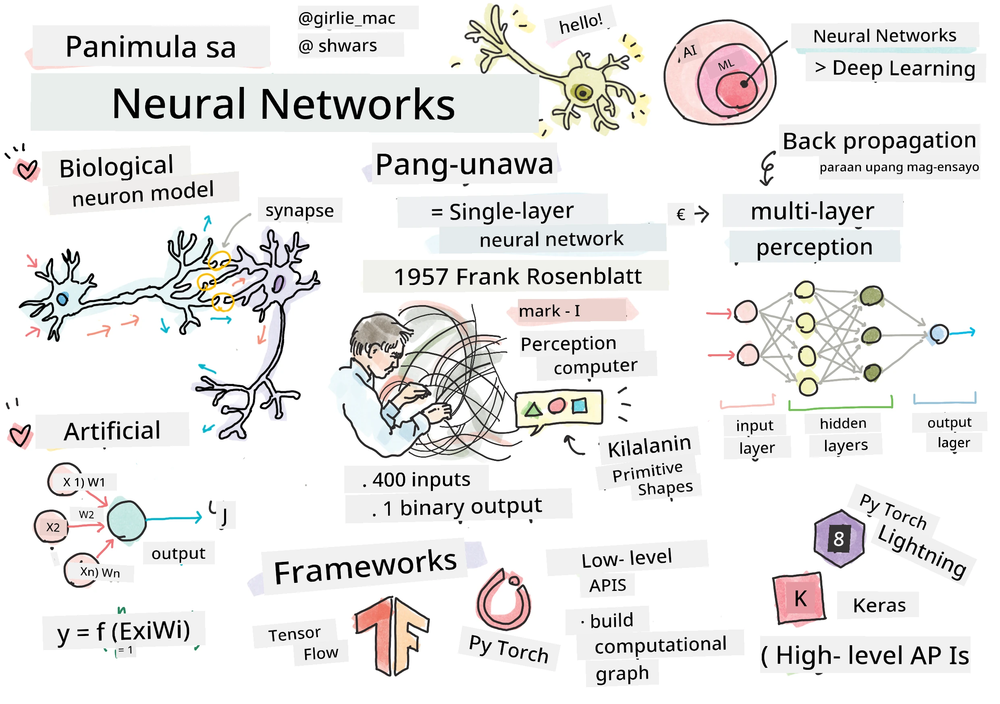
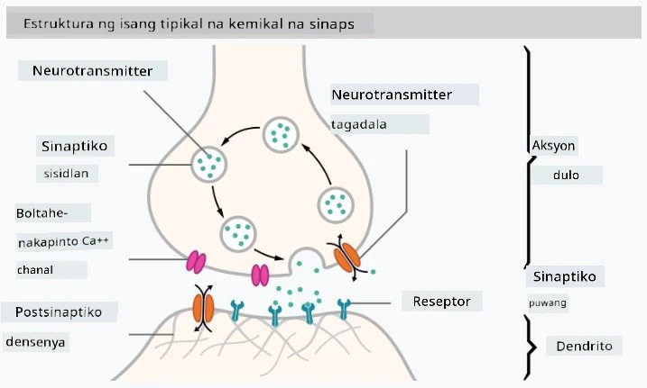

# Panimula sa mga Neural Networks

Tulad ng napag-usapan natin sa panimula, isa sa mga paraan upang makamit ang katalinuhan ay ang mag-train ng isang **computer model** o isang **artipisyal na utak**. Mula kalagitnaan ng ika-20 siglo, sinubukan ng mga mananaliksik ang iba't ibang matematikal na modelo, hanggang sa mga huling taon ay napatunayan na matagumpay ang direksyong ito. Ang mga matematikal na modelong ito ng utak ay tinatawag na **neural networks**.

> Minsan tinatawag ang neural networks bilang *Artificial Neural Networks*, ANNs, upang ipahiwatig na tayo ay tumutukoy sa mga modelo, hindi totoong mga network ng mga neuron.

## Machine Learning

Ang Neural Networks ay bahagi ng isang mas malaking disiplina na tinatawag na **Machine Learning**, na ang layunin ay gamitin ang datos upang mag-train ng mga computer model na kayang lutasin ang mga problema. Ang Machine Learning ay bumubuo ng malaking bahagi ng Artificial Intelligence, ngunit hindi namin tinatalakay ang klasikong ML sa kurikulung ito.

> Bisitahin ang aming hiwalay na **[Machine Learning for Beginners](http://github.com/microsoft/ml-for-beginners)** na kurikulum upang matuto pa tungkol sa klasikong Machine Learning.

Sa Machine Learning, ipinapalagay natin na mayroon tayong isang dataset ng mga halimbawa **X**, at mga kaukulang output na halaga **Y**. Ang mga halimbawa ay madalas na N-dimensional vectors na naglalaman ng **features**, at ang mga output ay tinatawag na **labels**.

Tatalakayin natin ang dalawang pinaka-karaniwang problema sa machine learning:

* **Classification**, kung saan kailangan nating i-classify ang isang input na bagay sa dalawa o higit pang klase.
* **Regression**, kung saan kailangan nating hulaan ang numerikal na halaga para sa bawat input na halimbawa.

> Kapag kinakatawan ang mga input at output bilang mga tensors, ang input dataset ay isang matrix na may sukat na M&times;N, kung saan ang M ay bilang ng mga samples at ang N ay bilang ng mga features. Ang output na labels Y ay isang vector na may sukat na M.

Sa kurikulung ito, magfo-focus lamang tayo sa mga neural network models.

## Isang Modelo ng Neuron

Mula sa biology, alam natin na ang ating utak ay binubuo ng mga neural cells (neurons), bawat isa ay may maraming "inputs" (dendrites) at isang "output" lamang (axon). Ang parehong dendrites at axons ay kayang magdala ng mga elektrikal na signal, at ang mga koneksyon sa pagitan nila — na kilala bilang synapses — ay maaaring magpakita ng iba't ibang antas ng conductivity, na kinokontrol ng mga neurotransmitters.

 | 
----|----
Totoong Neuron *([Image](https://en.wikipedia.org/wiki/Synapse#/media/File:SynapseSchematic_lines.svg) mula sa Wikipedia)* | Artipisyal na Neuron *(Larawan ng Author)*

Kaya, ang pinaka-simpleng matematikal na modelo ng isang neuron ay may ilang inputs X1, ..., XN at isang output na Y, at serye ng mga weights W1, ..., WN. Ang output ay kinakalkula bilang:

kung saan ang f ay isang non-linear na **activation function**.

> Ang mga maagang modelo ng neuron ay inilalarawan sa klasikong papel na [A logical calculus of the ideas immanent in nervous activity](https://www.cs.cmu.edu/~./epxing/Class/10715/reading/McCulloch.and.Pitts.pdf) nina Warren McCullock at Walter Pitts noong 1943. Si Donald Hebb sa kanyang aklat na "[The Organization of Behavior: A Neuropsychological Theory](https://books.google.com/books?id=VNetYrB8EBoC)" ay nagmungkahi kung paano matutrain ang mga network na iyon.

## Sa Seksyong ito

Sa seksyong ito ay matututuhan natin ang tungkol sa:
* [Perceptron](03-Perceptron/README.md), isa sa mga pinaka-maagang neural network model para sa dalawang-klaseng classification
* [Multi-layered networks](04-OwnFramework/README.md) kasama ang isang pares na notebook [kung paano gumawa ng sariling framework](04-OwnFramework/OwnFramework.ipynb)
* [Neural Network Frameworks](05-Frameworks/README.md), gamit ang mga notebook na ito: [PyTorch](05-Frameworks/IntroPyTorch.ipynb) at [Keras/Tensorflow](05-Frameworks/IntroKerasTF.ipynb)
* [Overfitting](../../../../lessons/3-NeuralNetworks/05-Frameworks#overfitting)

---

<!-- CO-OP TRANSLATOR DISCLAIMER START -->
**Pagtatanggi**:
Ang dokumentong ito ay isinalin gamit ang serbisyo ng AI translation na [Co-op Translator](https://github.com/Azure/co-op-translator). Bagama't nagsusumikap kami para sa katumpakan, pakatandaan na ang awtomatikong pagsasalin ay maaaring maglaman ng mga pagkakamali o hindi pagkakatugma. Ang orihinal na dokumento sa orihinal nitong wika ang dapat ituring na pangunahing sanggunian. Para sa mahahalagang impormasyon, inirerekomenda ang propesyonal na pagsasalin ng tao. Hindi kami mananagot sa anumang maling pagkakaintindi o maling interpretasyon na nagmula sa paggamit ng pagsasaling ito.
<!-- CO-OP TRANSLATOR DISCLAIMER END -->