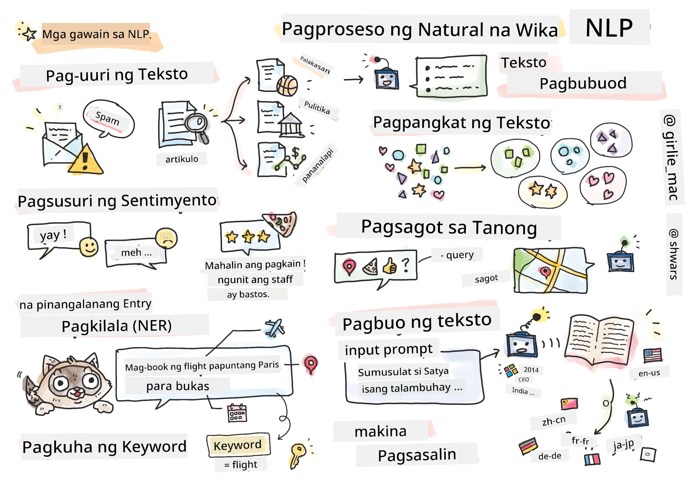

# Natural Language Processing



Sa seksyong ito, tututok tayo sa paggamit ng Neural Networks para hawakan ang mga gawain na may kaugnayan sa **Natural Language Processing (NLP)**. Maraming mga problema sa NLP na nais nating malutas ng mga kompyuter:

* **Text classification** ay isang tipikal na problema sa klasipikasyon na may kinalaman sa mga sunud-sunod na teksto. Halimbawa nito ay ang pagklasipika ng mga e-mail messages bilang spam laban sa hindi spam, o pag-uuri ng mga artikulo bilang isport, negosyo, pulitika, atbp. Kapag gumagawa ng chat bots, madalas kailangan nating maintindihan kung ano ang nais iparating ng gumagamit -- dito tayo nakikipagharap sa **intent classification**. Kadalasan, sa intent classification kailangan nating harapin ang maraming kategorya.
* **Sentiment analysis** ay isang tipikal na problema ng regresyon, kung saan kailangan nating magbigay ng numero (isang damdamin) na tumutukoy kung gaano kalakas ang positibo/negatibo ng kahulugan ng isang pangungusap. Ang mas advanced na bersyon ng sentiment analysis ay ang **aspect-based sentiment analysis** (ABSA), kung saan hindi lang ang buong pangungusap ang binibigyang damdamin, kundi ang iba't ibang bahagi nito (mga aspeto), halimbawa, *Sa restaurant na ito, nagustuhan ko ang putahe, pero ang atmosphere ay masama*.
* **Named Entity Recognition** (NER) ay tumutukoy sa problema ng pagkuha ng ilang mga entidad mula sa teksto. Halimbawa, kailangan nating maintindihan na sa pariralang *Kailangan kong lumipad papuntang Paris bukas* ang salitang *bukas* ay tumutukoy sa DATE, at ang *Paris* ay isang LOCATION.  
* **Keyword extraction** ay katulad ng NER, ngunit kailangan nating awtomatikong kunin ang mga salitang mahalaga sa kahulugan ng pangungusap, nang walang paunang pagsasanay para sa mga partikular na uri ng entidad.
* **Text clustering** ay maaaring maging kapaki-pakinabang kapag nais nating pagsamahin ang magkaparehong pangungusap, halimbawa, magkaparehong kahilingan sa mga usapan sa teknikal na suporta.
* **Question answering** ay tumutukoy sa kakayahan ng isang modelo na sagutin ang isang partikular na tanong. Tumatanggap ang modelo ng isang piraso ng teksto at isang tanong bilang inputs, at kailangan nitong magbigay ng lugar sa teksto kung saan nakapaloob ang sagot sa tanong (o, minsan, bumuo ng sagot).
* **Text Generation** ay ang kakayahan ng isang modelo na gumawa ng bagong teksto. Maaari itong ituring bilang isang problema ng klasipikasyon na hinuhulaan ang susunod na letra/salita base sa ilang *text prompt*. Ang mga advanced na modelo ng text generation, tulad ng GPT-3, ay kayang lutasin ang iba pang mga gawain sa NLP tulad ng klasipikasyon gamit ang teknik na tinatawag na [prompt programming](https://towardsdatascience.com/software-3-0-how-prompting-will-change-the-rules-of-the-game-a982fbfe1e0) o [prompt engineering](https://medium.com/swlh/openai-gpt-3-and-prompt-engineering-dcdc2c5fcd29)
* **Text summarization** ay isang teknik kung saan nais nating ipabasa ang isang mahabang teksto ng kompyuter at ibuod ito sa ilang pangungusap.
* **Machine translation** ay maaaring tingnan bilang kumbinasyon ng pag-unawa sa teksto sa isang wika, at paggawa ng teksto sa ibang wika.

Noong una, karamihan sa mga gawain sa NLP ay nilulutas gamit ang tradisyonal na mga pamamaraan tulad ng mga gramatika. Halimbawa, sa machine translation, ginagamit ang mga parser upang baguhin ang orihinal na pangungusap sa isang syntax tree, pagkatapos ay kinukuha ang mas mataas na lebel ng mga istrukturang semantiko para ilarawan ang kahulugan ng pangungusap, at batay sa kahulugang ito at gramatika ng target na wika ay nililikha ang resulta. Sa kasalukuyan, mas epektibong nalulutas ang maraming mga gawain sa NLP gamit ang mga neural networks.

> Maraming klasikong paraan ng NLP ang naipinatupad sa [Natural Language Processing Toolkit (NLTK)](https://www.nltk.org) Python library. Mayroong isang mahusay na [NLTK Book](https://www.nltk.org/book/) na magagamit online na tumatalakay kung paano malulutas ang iba't ibang mga gawain sa NLP gamit ang NLTK.

Sa kurso namin, higit nating tututukan ang paggamit ng Neural Networks para sa NLP, at gagamitin namin ang NLTK kung kinakailangan.

Natutunan na natin ang paggamit ng neural networks para hawakan ang tabular data at mga larawan. Ang pangunahing pagkakaiba ng mga uri ng data na ito sa teksto ay ang teksto ay isang sunud-sunod na data na may nagbabagong haba, habang ang input size sa mga larawan ay alam na nang maaga. Habang ang mga convolutional network ay makakakuha ng mga pattern mula sa input data, mas kumplikado ang mga pattern sa teksto. Halimbawa, maaari tayong magkaroon ng negasyon na nakahiwalay sa paksa nang walang tukoy na bilang ng mga salita (hal. *Hindi ko gusto ang mga dalandan*, kumpara sa, *Hindi ko gusto ang mga malalaking makukulay at masarap na dalandan*), ngunit dapat pa ring ituring ito bilang isang pattern. Kaya, upang hawakan ang wika, kailangan nating magpakilala ng mga bagong uri ng neural network, gaya ng *recurrent networks* at *transformers*.

## Install Libraries

Kung gumagamit ka ng lokal na Python installation para patakbuhin ang kurso na ito, maaaring kailanganin mong i-install ang lahat ng kinakailangang library para sa NLP gamit ang mga sumusunod na utos:

**Para sa PyTorch**
```bash
pip install -r requirements-pytorch.txt
```
**Para sa TensorFlow**
```bash
pip install -r requirements-tf.txt
```

> Maaari mong subukan ang NLP gamit ang TensorFlow sa [Microsoft Learn](https://docs.microsoft.com/learn/modules/intro-natural-language-processing-tensorflow/?WT.mc_id=academic-77998-cacaste)

## Babala sa GPU

Sa seksyong ito, sa ilang mga halimbawa ay magsasanay tayo ng medyo malalaking modelo.
* **Gumamit ng Kompyuter na May GPU**: Mas mainam na patakbuhin ang iyong mga notebook sa isang kompyuter na may GPU upang paliitin ang oras ng paghihintay kapag nagtatrabaho sa malalaking modelo.
* **Mga Limitasyon sa GPU Memory**: Ang paggamit ng GPU ay maaaring magdulot ng sitwasyon kung saan mauubusan ka ng GPU memory, lalo na kapag nagsasanay ng malalaking modelo.
* **Paggamit ng GPU Memory**: Ang dami ng GPU memory na nagagamit habang nagsasanay ay nakadepende sa iba't ibang salik, kasama na ang laki ng minibatch.
* **Bawasan ang Laki ng Minibatch**: Kung makaranas ka ng problema sa GPU memory, isaalang-alang ang pagbabawas ng laki ng minibatch sa iyong code bilang posibleng solusyon.
* **Pagpapalaya ng GPU Memory sa TensorFlow**: Ang mga lumang bersyon ng TensorFlow ay maaaring hindi tama na magpalaya ng GPU memory kapag nagsasanay ng maraming modelo sa loob ng isang Python kernel. Para epektibong pamahalaan ang paggamit ng GPU memory, maaari mong ayusin ang TensorFlow upang gumamit ng GPU memory ayon lang sa pangangailangan.
* **Paglalagay ng Code**: Upang itakda ang TensorFlow na palakihin lamang ang alokasyon ng GPU memory kapag kinakailangan, isama ang sumusunod na code sa iyong mga notebook:

```python
physical_devices = tf.config.list_physical_devices('GPU') 
if len(physical_devices)>0:
    tf.config.experimental.set_memory_growth(physical_devices[0], True) 
```

Kung interesado kang matuto tungkol sa NLP mula sa klasikong perspektibo ng ML, bisitahin ang [koleksyon ng mga leksyon na ito](https://github.com/microsoft/ML-For-Beginners/tree/main/6-NLP)

## Sa seksyong ito
Sa seksyong ito ay matututuhan natin ang tungkol sa:

* [Pagpapakita ng teksto bilang mga tensor](13-TextRep/README.md)
* [Word Embeddings](14-Embeddings/README.md)
* [Language Modeling](15-LanguageModeling/README.md)
* [Recurrent Neural Networks](16-RNN/README.md)
* [Generative Networks](17-GenerativeNetworks/README.md)
* [Transformers](18-Transformers/README.md)

---

<!-- CO-OP TRANSLATOR DISCLAIMER START -->
**Pagtatanggi**:
Ang dokumentong ito ay isinalin gamit ang serbisyo ng AI translation na [Co-op Translator](https://github.com/Azure/co-op-translator). Bagama't nagsusumikap kami para sa katumpakan, pakatandaan na ang awtomatikong pagsasalin ay maaaring maglaman ng mga pagkakamali o hindi pagkakatugma. Ang orihinal na dokumento sa orihinal nitong wika ang dapat ituring na pangunahing sanggunian. Para sa mahahalagang impormasyon, inirerekomenda ang propesyonal na pagsasalin ng tao. Hindi kami mananagot sa anumang maling pagkakaintindi o maling interpretasyon na nagmula sa paggamit ng pagsasaling ito.
<!-- CO-OP TRANSLATOR DISCLAIMER END -->