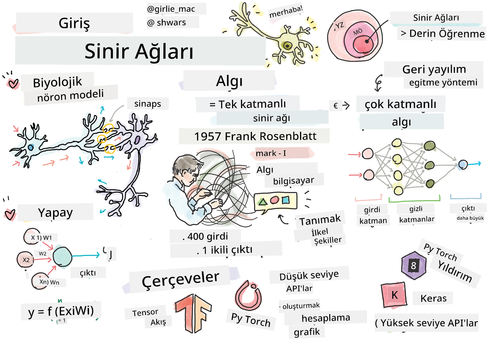
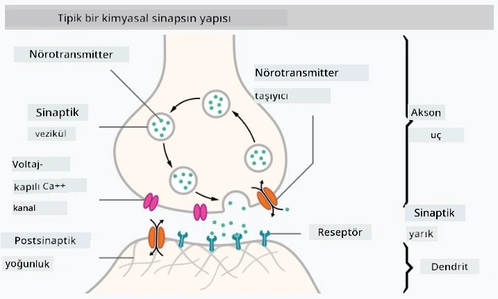

# Sinir Ağlarına Giriş

Girişte tartıştığımız gibi, zekaya ulaşmanın yollarından biri bir **bilgisayar modeli** veya bir **yapay beyin** eğitmektir. 20. yüzyılın ortalarından itibaren araştırmacılar çeşitli matematiksel modeller denediler, ta ki son yıllarda bu yön çok başarılı olduğu kanıtlanana kadar. Beynin böyle matematiksel modellerine **sinir ağları** denir.

> Bazen sinir ağları, gerçek nöron ağlarından bahsedilmediğini belirtmek için *Yapay Sinir Ağları*, ANN olarak anılır.

## Makine Öğrenimi

Sinir Ağları, veri kullanarak problemi çözebilen bilgisayar modelleri eğitmeyi amaçlayan **Makine Öğrenimi** adlı daha geniş bir disiplinin parçasıdır. Makine Öğrenimi, Yapay Zekanın büyük bir bölümünü oluşturur ancak bu müfredatta klasik ML ele alınmamaktadır.

> Klasik Makine Öğrenimi hakkında daha fazla bilgi edinmek için ayrı **[Makine Öğrenimine Yeni Başlayanlar İçin](http://github.com/microsoft/ml-for-beginners)** müfredatımıza göz atın.

Makine Öğreniminde, elimizde bazı örnekler içeren bir veri kümesi **X** ve karşılık gelen çıktı değerleri **Y** olduğunu varsayarız. Örnekler genellikle **özelliklerden** oluşan N boyutlu vektörlerdir ve çıktılara **etiketler** denir.

En yaygın iki makine öğrenimi problemini ele alacağız:

* Bir giriş nesnesini iki veya daha fazla sınıfa sınıflandırmamız gereken **Sınıflandırma**
* Giriş örneklerinin her biri için sayısal bir sayı tahmin etmemiz gereken **Regresyon**

> Girişler ve çıktılar tensör olarak temsil edildiğinde, giriş veri kümesi M×N boyutunda bir matrise sahiptir; burada M örnek sayısı, N ise özellik sayısıdır. Çıktı etiketleri Y, M boyutunda bir vektördür.

Bu müfredatta yalnızca sinir ağı modellerine odaklanacağız.

## Bir Nöronun Modeli

Biyolojiden biliyoruz ki beynimiz sinir hücrelerinden (nöronlardan) oluşur; her biri birden fazla "girişe" (dendritler) ve tek bir "çıktıya" (akson) sahiptir. Hem dendritler hem de aksonlar elektrik sinyallerini iletebilir ve aralarındaki bağlantılar — sinapslar — değişen iletkenlik seviyelerine sahip olabilir ve bu seviyeler nörotransmitterler tarafından düzenlenir.

 | 
----|----
Gerçek Nöron *([Resim](https://en.wikipedia.org/wiki/Synapse#/media/File:SynapseSchematic_lines.svg) Vikipedi'den)* | Yapay Nöron *(Resim yazar tarafından)*

Böylece, en basit matematiksel nöron modeli, X1, ..., XN gibi birkaç girdi ve Y adlı bir çıktı ve W1, ..., WN dizisi ağırlıklara sahiptir. Çıktı şu şekilde hesaplanır:

Burada f, bazı doğrusal olmayan **aktivasyon fonksiyonu**dur.

> Nöronun erken modelleri, Warren McCullock ve Walter Pitts'in 1943 tarihli klasik makalesi [A logical calculus of the ideas immanent in nervous activity](https://www.cs.cmu.edu/~./epxing/Class/10715/reading/McCulloch.and.Pitts.pdf) ile tanımlandı. Donald Hebb, "[The Organization of Behavior: A Neuropsychological Theory](https://books.google.com/books?id=VNetYrB8EBoC)" adlı kitabında bu ağların nasıl eğitilebileceğini önerdi.

## Bu Bölümde

Bu bölümde şunları öğreneceğiz:
* [Perceptron](03-Perceptron/README.md), iki sınıflı sınıflandırma için en erken sinir ağı modellerinden biri
* [Çok katmanlı ağlar](04-OwnFramework/README.md) ve eşlenmiş bir not defteri [kendi çerçevemizi nasıl kurarız](04-OwnFramework/OwnFramework.ipynb)
* [Sinir Ağı Çerçeveleri](05-Frameworks/README.md), bu not defterleri ile: [PyTorch](05-Frameworks/IntroPyTorch.ipynb) ve [Keras/Tensorflow](05-Frameworks/IntroKerasTF.ipynb)
* [Aşırı Öğrenme](../../../../lessons/3-NeuralNetworks/05-Frameworks#overfitting)

---

<!-- CO-OP TRANSLATOR DISCLAIMER START -->
**Feragatname**:
Bu belge, AI çeviri hizmeti [Co-op Translator](https://github.com/Azure/co-op-translator) kullanılarak çevrilmiştir. Doğruluk için çaba sarf etsek de, otomatik çevirilerin hata veya yanlışlık içerebileceğini lütfen unutmayınız. Orijinal belge, kendi dilinde yetkili kaynak olarak kabul edilmelidir. Kritik bilgiler için profesyonel insan çevirisi önerilir. Bu çevirinin kullanımı sonucu ortaya çıkabilecek yanlış anlamalardan veya yanlış yorumlamalardan sorumlu değiliz.
<!-- CO-OP TRANSLATOR DISCLAIMER END -->