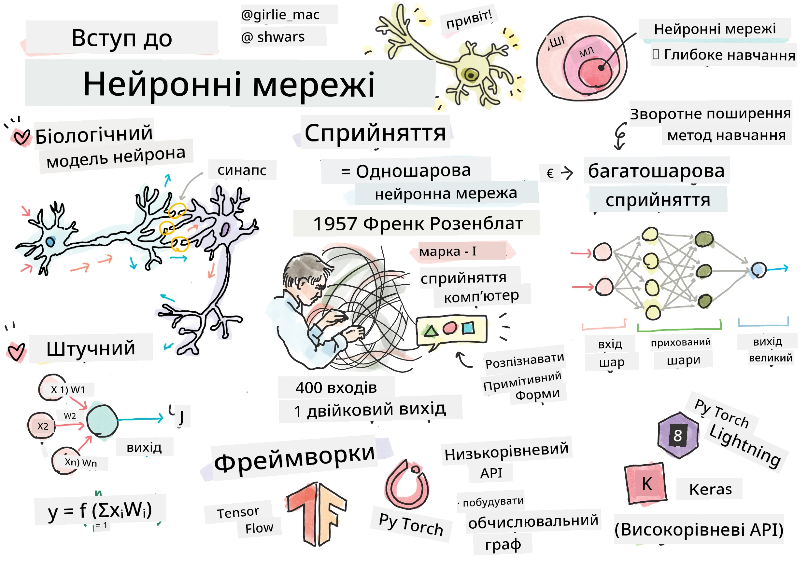
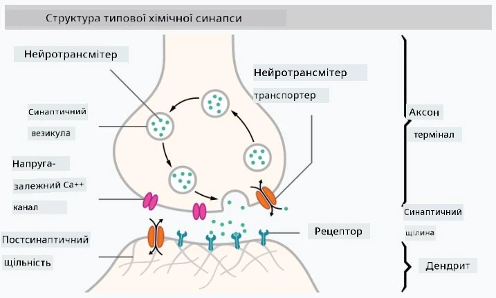

# Вступ до нейронних мереж

Як ми обговорювали у вступі, одним із способів досягти інтелекту є навчання **комп'ютерної моделі** або **штучного мозку**. З середини XX століття дослідники випробовували різні математичні моделі, поки в останні роки цей напрям виявився надзвичайно успішним. Такі математичні моделі мозку називаються **нейронними мережами**.

> Іноді нейронні мережі називають *штучними нейронними мережами*, ANN, щоб підкреслити, що йдеться про моделі, а не про реальні мережі нейронів.

## Машинне навчання

Нейронні мережі є частиною більшої дисципліни під назвою **машинне навчання**, мета якої — використовувати дані для навчання комп'ютерних моделей, здатних розв'язувати завдання. Машинне навчання складає велику частину штучного інтелекту, однак ми не охоплюємо класичне машинне навчання у цій програмі.

> Відвідайте окрему програму **[Машинне навчання для початківців](http://github.com/microsoft/ml-for-beginners)**, щоб дізнатись більше про класичне машинне навчання.

У машинному навчанні ми припускаємо, що маємо деякий набір даних прикладів **X** та відповідні вихідні значення **Y**. Приклади часто є N-вимірними векторами, які складаються з **ознаок**, а виходи називають **мітками**.

Розглянемо дві найпоширеніші задачі машинного навчання:

* **Класифікація**, де потрібно класифікувати вхідний об’єкт на дві або більше категорій.
* **Регресія**, де потрібно передбачити числове значення для кожного з вхідних зразків.

> При представленні входів і виходів у вигляді тензорів, вхідний набір даних — це матриця розміру M&times;N, де M — кількість зразків, а N — кількість ознак. Вихідні мітки Y — це вектор розміру M.

У цій програмі ми зосередимося лише на моделях нейронних мереж.

## Модель нейрона

З біології відомо, що наш мозок складається з нейронних клітин (нейронів), кожен з яких має кілька "входів" (дендритів) і один "вихід" (аксон). І дендрити, і аксони можуть проводити електричні сигнали, а з’єднання між ними — так звані синапси — можуть проявляти різний ступінь провідності, яку регулюють нейромедіатори.

 | 
----|----
Реальний нейрон *([Зображення](https://en.wikipedia.org/wiki/Synapse#/media/File:SynapseSchematic_lines.svg) з Вікіпедії)* | Штучний нейрон *(Зображення автора)*

Таким чином, найпростіша математична модель нейрона містить кілька входів X1, ..., XN та один вихід Y, а також набір ваг W1, ..., WN. Вихід розраховується як:

де f — деяка нелінійна **активаційна функція**.

> Ранні моделі нейрона були описані у класичній статті [Логічний калькулятор ідей, притаманних нервовій активності](https://www.cs.cmu.edu/~./epxing/Class/10715/reading/McCulloch.and.Pitts.pdf) Уоррена МакКалока та Уолтера Піттса 1943 року. Дональд Хебб у своїй книзі "[Організація поведінки: нейропсихологічна теорія](https://books.google.com/books?id=VNetYrB8EBoC)" запропонував спосіб навчання таких мереж.

## У цьому розділі

У цьому розділі ми вивчимо:
* [Персептрон](03-Perceptron/README.md), одну з найперших моделей нейронних мереж для класифікації двох класів
* [Багатошарові мережі](04-OwnFramework/README.md) з відповідною ноутбук-інструкцією [як побудувати власний фреймворк](04-OwnFramework/OwnFramework.ipynb)
* [Фреймворки нейронних мереж](05-Frameworks/README.md) з цими ноутбуками: [PyTorch](05-Frameworks/IntroPyTorch.ipynb) і [Keras/Tensorflow](05-Frameworks/IntroKerasTF.ipynb)
* [Переобучення](../../../../lessons/3-NeuralNetworks/05-Frameworks#overfitting)

---

<!-- CO-OP TRANSLATOR DISCLAIMER START -->
**Відмова від відповідальності**:
Цей документ було перекладено за допомогою сервісу штучного інтелекту для перекладу [Co-op Translator](https://github.com/Azure/co-op-translator). Хоча ми прагнемо до точності, будь ласка, майте на увазі, що автоматичні переклади можуть містити помилки або неточності. Оригінальний документ рідною мовою слід вважати авторитетним джерелом. Для критично важливої інформації рекомендується професійний людський переклад. Ми не несемо відповідальності за будь-які непорозуміння або неправильні тлумачення, що виникли внаслідок використання цього перекладу.
<!-- CO-OP TRANSLATOR DISCLAIMER END -->