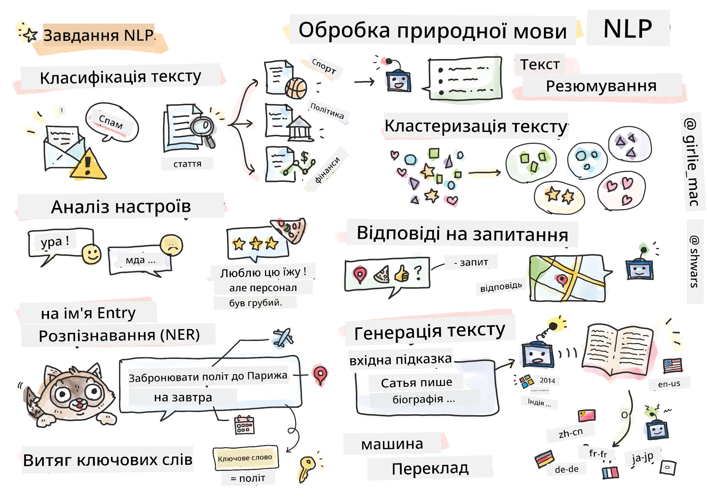

# Обробка природної мови



У цьому розділі ми зосередимося на використанні нейронних мереж для вирішення завдань, пов’язаних з **обробкою природної мови (ОПМ)**. Існує багато проблем обробки природної мови, які ми хочемо, щоб комп’ютери могли розв’язувати:

* **Класифікація тексту** — це типова задача класифікації, що стосується текстових послідовностей. Прикладами є класифікація електронних листів як спам чи не спам, або категоризація статей як спорт, бізнес, політика тощо. Також при розробці чат-ботів часто потрібно розуміти, що користувач хотів сказати — у цьому випадку ми маємо справу з **класифікацією намірів**. Часто при класифікації намірів потрібно працювати з багатьма категоріями.
* **Аналіз сентименту** — це типове завдання регресії, у якому потрібно приписати числове значення (сентимент), що відповідає тому, наскільки позитивним чи негативним є значення речення. Більш розвиненою версією аналізу сентименту є **аналіз сентименту за аспектами** (ABSA), де сентимент приписується не всьому реченню, а різним його частинам (аспектам), наприклад *У цьому ресторані мені сподобалася кухня, але атмосфера була жахливою*.
* **Розпізнавання іменованих сутностей** (NER) — це задача вилучення певних сутностей із тексту. Наприклад, нам може знадобитися зрозуміти, що у фразі *Мені потрібно летіти до Парижа завтра* слово *завтра* позначає ДАТУ, а *Париж* — це ЛОКАЦІЯ.  
* **Виділення ключових слів** схоже на NER, але потрібно автоматично виділяти слова, важливі для значення речення, без попереднього навчання для конкретних типів сутностей.
* **Кластеризація тексту** може бути корисною, коли потрібно групувати схожі речення, наприклад, схожі запити у розмовах технічної підтримки.
* **Відповіді на запитання** означають здатність моделі відповідати на конкретні запитання. Модель отримує на вхід текстовий фрагмент і запитання, і їй потрібно вказати місце в тексті, де міститься відповідь на запитання (або, іноді, згенерувати текст відповіді).
* **Генерація тексту** — це здатність моделі генерувати новий текст. Це можна розглядати як задачу класифікації, яка передбачає наступну букву/слово на основі деякого *текстового підказки*. Сучасні моделі генерації тексту, такі як GPT-3, можуть вирішувати й інші задачі NLP, наприклад класифікацію, використовуючи техніку, що називається [prompt programming](https://towardsdatascience.com/software-3-0-how-prompting-will-change-the-rules-of-the-game-a982fbfe1e0) або [prompt engineering](https://medium.com/swlh/openai-gpt-3-and-prompt-engineering-dcdc2c5fcd29)
* **Підсумовування тексту** — це техніка, коли ми хочемо, щоб комп’ютер "прочитав" довгий текст і підсумував його у кілька речень.
* **Машинний переклад** можна розглядати як поєднання розуміння тексту однією мовою і генерації тексту іншою.

Спочатку більшість завдань NLP розв’язувалися за допомогою традиційних методів, таких як граматики. Наприклад, у машинному перекладі використовували парсери для трансформації початкового речення у синтаксичне дерево, потім витягувалися семантичні структури вищого рівня для представлення значення речення, і на основі цього значення та граматики цільової мови генерувався результат. На сьогоднішній день багато задач NLP ефективніше розв’язуються за допомогою нейронних мереж.

> Багато класичних методів NLP реалізовані у бібліотеці Python [Natural Language Processing Toolkit (NLTK)](https://www.nltk.org). Є чудова онлайн-книга [NLTK Book](https://www.nltk.org/book/), яка демонструє, як розв’язувати різні завдання NLP за допомогою NLTK.

У нашому курсі ми переважно зосередимося на використанні нейронних мереж для NLP і будемо застосовувати NLTK там, де це потрібно.

Ми вже вивчали використання нейронних мереж для роботи з табличними даними та зображеннями. Основна відмінність між цими типами даних і текстом полягає у тому, що текст є послідовністю змінної довжини, тоді як розмір вхідних даних у випадку зображень відомий заздалегідь. Хоча згорткові мережі можуть видобувати шаблони з вхідних даних, шаблони в тексті є більш складними. Наприклад, заперечення може бути віддалене від підмета на довільну кількість слів (наприклад, *I do not like oranges* проти *I do not like those big colorful tasty oranges*), і це має інтерпретуватися як один шаблон. Тому для роботи з мовою нам потрібно вводити нові типи нейронних мереж, такі як *рекурентні мережі* і *трансформери*.

## Встановлення бібліотек

Якщо ви використовуєте локальну інсталяцію Python для проходження цього курсу, можливо, вам потрібно буде встановити всі необхідні бібліотеки для NLP за допомогою наступних команд:

**Для PyTorch**
```bash
pip install -r requirements-pytorch.txt
```
**Для TensorFlow**
```bash
pip install -r requirements-tf.txt
```

> Ви можете спробувати NLP з TensorFlow на [Microsoft Learn](https://docs.microsoft.com/learn/modules/intro-natural-language-processing-tensorflow/?WT.mc_id=academic-77998-cacaste)

## Попередження щодо GPU

У цьому розділі у деяких прикладах ми будемо навчати досить великі моделі.
* **Використовуйте комп’ютер з підтримкою GPU**: Рекомендується запускати ваші ноутбуки на комп’ютері з GPU, щоб зменшити час очікування під час роботи з великими моделями.
* **Обмеження пам’яті GPU**: Робота на GPU може призводити до ситуацій, коли пам’ять GPU закінчується, особливо при навчанні великих моделей.
* **Споживання пам’яті GPU**: Об’єм пам’яті GPU, що використовується під час навчання, залежить від різних факторів, включно з розміром мінібачу.
* **Мінімізуйте розмір мінібачу**: Якщо ви зіштовхуєтеся з проблемами пам’яті GPU, розгляньте можливість зменшення розміру мінібачу у вашому коді як потенційне рішення.
* **Звільнення пам’яті GPU у TensorFlow**: Старіші версії TensorFlow можуть некоректно звільняти пам’ять GPU при навчанні кількох моделей в одному Python-ядрі. Щоб ефективно керувати використанням пам’яті GPU, ви можете налаштувати TensorFlow так, щоб виділяти пам’ять GPU лише за потребою.
* **Включення коду**: Щоб налаштувати TensorFlow на поступове збільшення виділення пам’яті GPU лише тоді, коли це потрібно, додайте наступний код у свої зошити:

```python
physical_devices = tf.config.list_physical_devices('GPU') 
if len(physical_devices)>0:
    tf.config.experimental.set_memory_growth(physical_devices[0], True) 
```

Якщо ви хочете дізнатись про NLP з класичної точки зору машинного навчання, відвідайте [цей набір уроків](https://github.com/microsoft/ML-For-Beginners/tree/main/6-NLP)

## У цьому розділі
У цьому розділі ми навчимось:

* [Представляти текст як тензори](13-TextRep/README.md)
* [Словникові вбудовування](14-Embeddings/README.md)
* [Моделювання мови](15-LanguageModeling/README.md)
* [Рекурентні нейронні мережі](16-RNN/README.md)
* [Генеративні мережі](17-GenerativeNetworks/README.md)
* [Трансформери](18-Transformers/README.md)

---

<!-- CO-OP TRANSLATOR DISCLAIMER START -->
**Відмова від відповідальності**:
Цей документ було перекладено за допомогою сервісу штучного інтелекту для перекладу [Co-op Translator](https://github.com/Azure/co-op-translator). Хоча ми прагнемо до точності, будь ласка, майте на увазі, що автоматичні переклади можуть містити помилки або неточності. Оригінальний документ рідною мовою слід вважати авторитетним джерелом. Для критично важливої інформації рекомендується професійний людський переклад. Ми не несемо відповідальності за будь-які непорозуміння або неправильні тлумачення, що виникли внаслідок використання цього перекладу.
<!-- CO-OP TRANSLATOR DISCLAIMER END -->