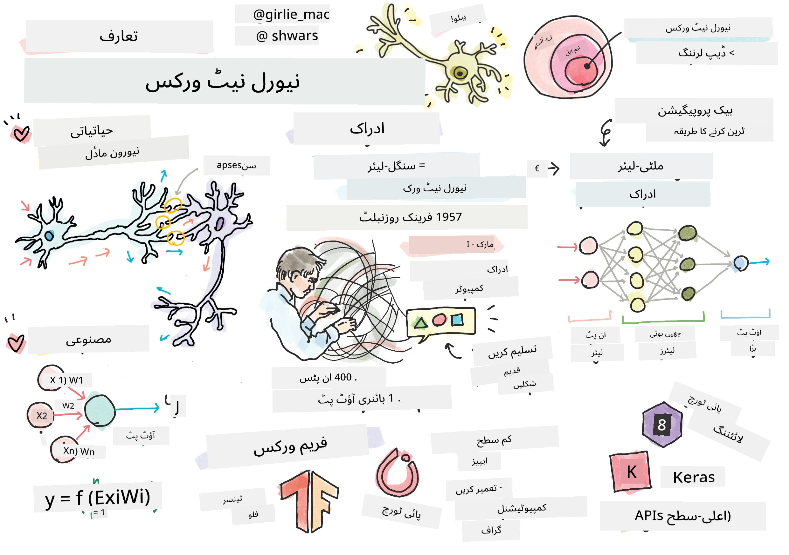
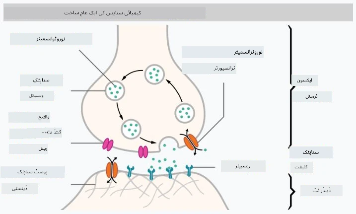
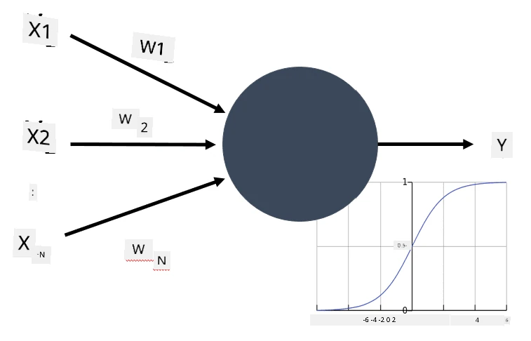
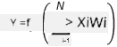

# نیورل نیٹ ورکس کا تعارف

جیسا کہ ہم نے تعارف میں بات کی، ذہانت حاصل کرنے کے طریقوں میں سے ایک طریقہ **کمپیوٹر ماڈل** یا ایک **مصنوعی دماغ** کو تربیت دینا ہے۔ بیسویں صدی کے وسط سے محققین نے مختلف ریاضیاتی ماڈلز آزمایے، یہاں تک کہ حالیہ برسوں میں یہ سمت بہت کامیاب ثابت ہوئی۔ دماغ کے ایسے ریاضیاتی ماڈلز کو **نیورل نیٹ ورکس** کہا جاتا ہے۔

> کبھی کبھار نیورل نیٹ ورکس کو *مصنوعی نیورل نیٹ ورکس*، ANNs کہا جاتا ہے، تاکہ یہ ظاہر کیا جا سکے کہ ہم حقیقی نیورونز کے جال کی بجائے ماڈلز کی بات کر رہے ہیں۔

## مشین لرننگ

نیورل نیٹ ورکس ایک بڑے شعبے **مشین لرننگ** کا حصہ ہیں، جس کا مقصد ڈیٹا کا استعمال کر کے ایسے کمپیوٹر ماڈلز کی تربیت دینا ہے جو مسائل کو حل کر سکیں۔ مشین لرننگ مصنوعی ذہانت کا ایک بڑا حصہ ہے، تاہم ہم اس نصاب میں کلاسیکی مشین لرننگ کا احاطہ نہیں کرتے۔

> مزید جاننے کے لیے ہمارے علیحدہ **[مشین لرننگ برائے آغاز کنندگان](http://github.com/microsoft/ml-for-beginners)** نصاب کا دورہ کریں۔

مشین لرننگ میں، ہم فرض کرتے ہیں کہ ہمارے پاس کچھ مثالوں کا مجموعہ **X** اور متعلقہ آؤٹ پٹ ویلیوز **Y** موجود ہیں۔ مثالیں اکثر N-بعدی ویکٹرز ہوتے ہیں جو **صفات** پر مشتمل ہوتے ہیں، اور آؤٹ پٹس کو **لیبلز** کہا جاتا ہے۔

ہم دو سب سے عام مشین لرننگ کے مسائل کو زیر غور لائیں گے:

* **درجہ بندی** (Classification)، جہاں ہمیں کسی ان پٹ آئٹم کو دو یا زیادہ کلاسز میں تقسیم کرنا ہوتا ہے۔
* **رجریشن** (Regression)، جہاں ہمیں ہر ان پٹ نمونہ کے لیے ایک عددی قیمت پیش کرنی ہوتی ہے۔

> جب ان پٹس اور آؤٹ پٹس کو ٹینسرز کی صورت میں ظاہر کیا جاتا ہے، تو ان پٹ ڈیٹا سیٹ ایک M×N میٹرکس ہوتا ہے، جہاں M سیمپلز کی تعداد ہے اور N صفات کی تعداد ہے۔ آؤٹ پٹ لیبلز Y M سائز کا ویکٹر ہے۔

اس نصاب میں ہم صرف نیورل نیٹ ورک ماڈلز پر توجہ مرکوز کریں گے۔

## نیوران کا ماڈل

حیاتیات سے معلوم ہے کہ ہمارا دماغ نیورل خلیات (نیورونز) پر مشتمل ہوتا ہے، ہر نیورون کے کئی "ان پٹس" (ڈینڈریٹس) اور ایک "آؤٹ پٹ" (ایکسون) ہوتا ہے۔ دونوں ڈینڈریٹس اور ایکسونز برقی سگنلز منتقل کر سکتے ہیں، اور ان کے درمیان جو رابطے ہوتے ہیں جنہیں سنایپسز کہا جاتا ہے، وہ مختلف سطح کی برقی چالکتا دکھا سکتے ہیں جو نیوروٹرانسمیٹرز کے ذریعے کنٹرول ہوتی ہے۔

 | 
----|----
حقیقی نیوران *([تصویر](https://en.wikipedia.org/wiki/Synapse#/media/File:SynapseSchematic_lines.svg) ویکیپیڈیا سے)* | مصنوعی نیوران *(مصنف کی تصویر)*

اس طرح، نیوران کے سب سے آسان ریاضیاتی ماڈل میں کئی ان پٹ X1, ..., XN اور ایک آؤٹ پٹ Y، اور کئی وزن W1, ..., WN شامل ہوتے ہیں۔ آؤٹ پٹ یوں حساب ہوتا ہے:

جہاں f کوئی غیر خطی **ایکٹیویشن فنکشن** ہوتی ہے۔

> نیوران کے ابتدائی ماڈلز 1943 میں وارن میک کلک اور والٹر پیٹس کے کلاسیکی مقالے [A logical calculus of the ideas immanent in nervous activity](https://www.cs.cmu.edu/~./epxing/Class/10715/reading/McCulloch.and.Pitts.pdf) میں بیان کیے گئے تھے۔ ڈونلڈ ہیب نے اپنی کتاب "[The Organization of Behavior: A Neuropsychological Theory](https://books.google.com/books?id=VNetYrB8EBoC)" میں انہیں تربیت دینے کا طریقہ تجویز کیا۔

## اس سیکشن میں

اس سیکشن میں ہم سیکھیں گے:
* [پرسیپٹرون](03-Perceptron/README.md)، دو کلاسوں کی درجہ بندی کے لیے ابتدائی نیورل نیٹ ورک ماڈلوں میں سے ایک
* [ملٹی لیئرڈ نیٹ ورکس](04-OwnFramework/README.md) کے ساتھ ملحق نوٹ بک [اپنا فریم ورک کیسے بنائیں](04-OwnFramework/OwnFramework.ipynb)
* [نیورل نیٹ ورک فریم ورکس](05-Frameworks/README.md)، ان نوٹ بکس کے ساتھ: [پائی ٹورچ](05-Frameworks/IntroPyTorch.ipynb) اور [کیراس/ٹینسر فلو](05-Frameworks/IntroKerasTF.ipynb)
* [اوورفٹنگ](../../../../lessons/3-NeuralNetworks/05-Frameworks#overfitting)

---

<!-- CO-OP TRANSLATOR DISCLAIMER START -->
**ڈس کلیمر**:
یہ دستاویز AI ترجمہ سروس [Co-op Translator](https://github.com/Azure/co-op-translator) کے ذریعے ترجمہ کی گئی ہے۔ جبکہ ہم درستگی کے لیے کوشاں ہیں، براہ کرم اس بات سے آگاہ رہیں کہ خودکار ترجمے میں غلطیاں یا عدم درستیاں ہو سکتی ہیں۔ اصل دستاویز اپنے مادری زبان میں مستند ماخذ سمجھی جائے گی۔ حساس معلومات کے لیے پیشہ ور انسانی ترجمہ کی سفارش کی جاتی ہے۔ اس ترجمے کے استعمال سے پیدا ہونے والی کسی بھی غلط فہمی یا غلط تشریح کی ذمہ داری ہم قبول نہیں کرتے۔
<!-- CO-OP TRANSLATOR DISCLAIMER END -->