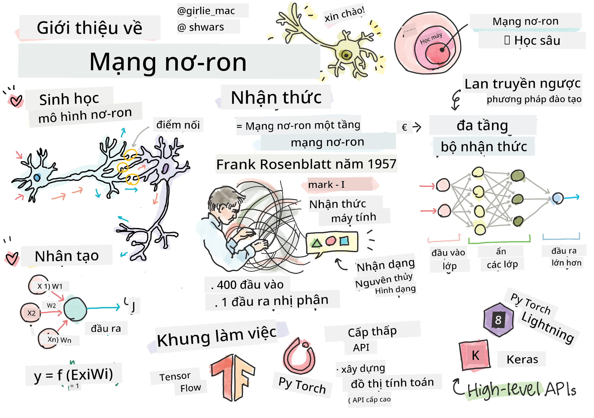
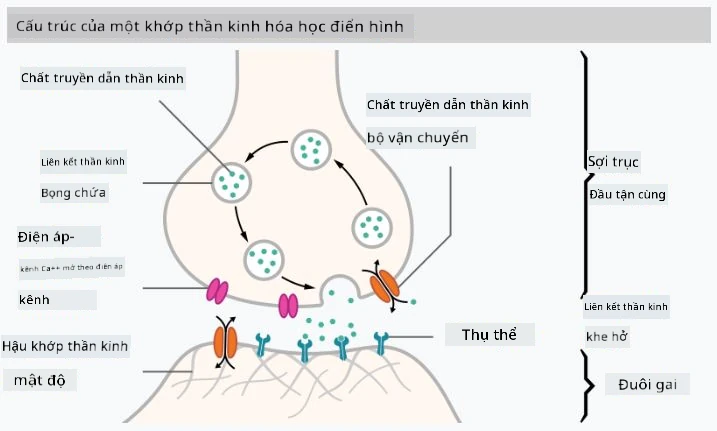

# Giới thiệu về Mạng Nơ-ron

Như chúng ta đã thảo luận trong phần giới thiệu, một trong những cách để đạt được trí thông minh là đào tạo một **mô hình máy tính** hoặc một **bộ não nhân tạo**. Kể từ giữa thế kỷ 20, các nhà nghiên cứu đã thử nghiệm các mô hình toán học khác nhau, cho đến những năm gần đây phương hướng này đã chứng minh được sự thành công lớn. Những mô hình toán học của bộ não như vậy được gọi là **mạng nơ-ron**.

> Đôi khi mạng nơ-ron còn được gọi là *Mạng Nơ-ron Nhân tạo*, ANN, để chỉ rằng chúng ta đang nói về các mô hình, không phải mạng nơ-ron thật sự.

## Học Máy

Mạng nơ-ron là một phần của ngành học lớn hơn gọi là **Học Máy**, với mục tiêu sử dụng dữ liệu để đào tạo các mô hình máy tính có khả năng giải quyết vấn đề. Học Máy chiếm một phần lớn trong Trí tuệ Nhân tạo, tuy nhiên, chúng tôi không trình bày về học máy cổ điển trong chương trình này.

> Hãy truy cập chương trình riêng của chúng tôi **[Học Máy cho Người Mới Bắt Đầu](http://github.com/microsoft/ml-for-beginners)** để tìm hiểu thêm về học máy cổ điển.

Trong học máy, chúng ta giả sử có một bộ dữ liệu các ví dụ **X**, cùng với các giá trị đầu ra tương ứng **Y**. Các ví dụ thường là các vectơ N chiều bao gồm các **đặc trưng**, và đầu ra được gọi là **nhãn**.

Chúng ta sẽ xem xét hai bài toán học máy phổ biến nhất:

* **Phân loại**, nơi cần phân loại một đối tượng đầu vào vào hai hay nhiều lớp.
* **Hồi quy**, nơi cần dự đoán một số giá trị số cho mỗi mẫu đầu vào.

> Khi biểu diễn đầu vào và đầu ra dưới dạng tensor, bộ dữ liệu đầu vào là một ma trận kích thước M&times;N, trong đó M là số mẫu và N là số đặc trưng. Nhãn đầu ra Y là vectơ kích thước M.

Trong chương trình này, chúng ta chỉ tập trung vào các mô hình mạng nơ-ron.

## Mô hình một Nơ-ron

Từ sinh học, chúng ta biết rằng bộ não của chúng ta gồm các tế bào thần kinh (nơ-ron), mỗi tế bào có nhiều “đầu vào” (dendrite) và một “đầu ra” duy nhất (axon). Cả dendrite và axon đều có thể dẫn tín hiệu điện, và các kết nối giữa chúng — gọi là synapse — có độ dẫn khác nhau, được điều chỉnh bởi các chất dẫn truyền thần kinh.

 | 
----|----
Nơ-ron Thật *([Hình ảnh](https://en.wikipedia.org/wiki/Synapse#/media/File:SynapseSchematic_lines.svg) từ Wikipedia)* | Nơ-ron Nhân tạo *(Hình ảnh của tác giả)*

Do đó, mô hình toán học đơn giản nhất của một nơ-ron có nhiều đầu vào X1, ..., XN và một đầu ra Y, cùng với một chuỗi trọng số W1, ..., WN. Đầu ra được tính bằng:

trong đó f là một **hàm kích hoạt** phi tuyến.

> Các mô hình nơ-ron đầu tiên được mô tả trong bài báo kinh điển [A logical calculus of the ideas immanent in nervous activity](https://www.cs.cmu.edu/~./epxing/Class/10715/reading/McCulloch.and.Pitts.pdf) của Warren McCullock và Walter Pitts năm 1943. Donald Hebb trong cuốn sách "[The Organization of Behavior: A Neuropsychological Theory](https://books.google.com/books?id=VNetYrB8EBoC)" đề xuất cách mạng đó có thể được đào tạo.

## Trong Phần này

Trong phần này, chúng ta sẽ tìm hiểu về:
* [Perceptron](03-Perceptron/README.md), một trong những mô hình mạng nơ-ron sớm nhất cho bài toán phân loại hai lớp
* [Mạng nhiều lớp](04-OwnFramework/README.md) kèm theo sổ tay thực hành [cách xây dựng framework của riêng chúng ta](04-OwnFramework/OwnFramework.ipynb)
* [Framework Mạng Nơ-ron](05-Frameworks/README.md), với các sổ tay: [PyTorch](05-Frameworks/IntroPyTorch.ipynb) và [Keras/Tensorflow](05-Frameworks/IntroKerasTF.ipynb)
* [Quá khớp](../../../../lessons/3-NeuralNetworks/05-Frameworks#overfitting)

---

<!-- CO-OP TRANSLATOR DISCLAIMER START -->
**Tuyên bố miễn trừ trách nhiệm**:
Tài liệu này đã được dịch bằng dịch vụ dịch thuật AI [Co-op Translator](https://github.com/Azure/co-op-translator). Mặc dù chúng tôi cố gắng đảm bảo độ chính xác, xin lưu ý rằng bản dịch tự động có thể chứa lỗi hoặc sai sót. Tài liệu gốc bằng ngôn ngữ gốc nên được coi là nguồn tin chính thức. Đối với thông tin quan trọng, nên sử dụng dịch vụ dịch thuật chuyên nghiệp bởi con người. Chúng tôi không chịu trách nhiệm về bất kỳ hiểu lầm hoặc giải thích sai nào phát sinh từ việc sử dụng bản dịch này.
<!-- CO-OP TRANSLATOR DISCLAIMER END -->