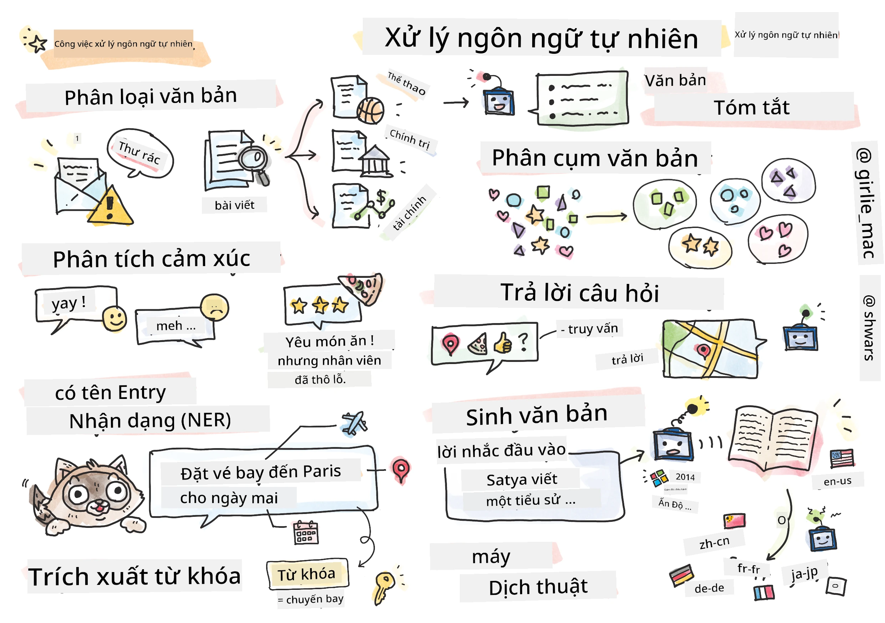

# Xử Lý Ngôn Ngữ Tự Nhiên



Trong phần này, chúng ta sẽ tập trung vào việc sử dụng Mạng Nơ-ron để xử lý các nhiệm vụ liên quan đến **Xử Lý Ngôn Ngữ Tự Nhiên (NLP)**. Có nhiều vấn đề NLP mà chúng ta muốn máy tính có thể giải quyết:

* **Phân loại văn bản** là một bài toán phân loại điển hình liên quan đến các chuỗi văn bản. Ví dụ bao gồm phân loại các thư điện tử là thư rác hay không thư rác, hoặc phân loại các bài báo thuộc thể thao, kinh doanh, chính trị, vv. Ngoài ra, khi phát triển chat bot, chúng ta thường cần hiểu người dùng muốn nói gì -- trong trường hợp này chúng ta xử lý **phân loại ý định**. Thường thì, trong phân loại ý định chúng ta cần xử lý nhiều loại.
* **Phân tích tình cảm** là một bài toán hồi quy điển hình, trong đó chúng ta cần gán một con số (một giá trị tình cảm) tương ứng với mức độ tích cực/tiêu cực của ý nghĩa một câu. Phiên bản nâng cao hơn của phân tích tình cảm là **phân tích tình cảm dựa trên khía cạnh** (ABSA), trong đó chúng ta gán tình cảm không phải cho toàn bộ câu, mà cho các phần khác nhau của nó (các khía cạnh), ví dụ *Ở nhà hàng này, tôi thích món ăn, nhưng không gian rất tệ*.
* **Nhận dạng Thực thể Đặt tên** (NER) ám chỉ bài toán trích xuất một số thực thể nhất định từ văn bản. Ví dụ, chúng ta có thể cần hiểu rằng trong cụm từ *Tôi cần bay đến Paris vào ngày mai* thì từ *ngày mai* thuộc về NGÀY THÁNG, và *Paris* là một ĐỊA ĐIỂM.
* **Trích xuất từ khóa** giống với NER, nhưng chúng ta cần tự động trích xuất các từ quan trọng với ý nghĩa của câu, mà không phải huấn luyện trước cho các loại thực thể cụ thể.
* **Phân nhóm văn bản** có thể hữu ích khi chúng ta muốn gom nhóm các câu tương tự lại với nhau, ví dụ, các yêu cầu tương tự trong các cuộc trò chuyện hỗ trợ kỹ thuật.
* **Trả lời câu hỏi** ám chỉ khả năng của mô hình để trả lời một câu hỏi cụ thể. Mô hình nhận một đoạn văn bản và một câu hỏi làm đầu vào, và nó cần cung cấp vị trí trong văn bản chứa câu trả lời cho câu hỏi đó (hoặc đôi khi tạo ra văn bản trả lời).
* **Tạo văn bản** là khả năng của mô hình để tạo ra văn bản mới. Nó có thể được xem như một bài toán phân loại dự đoán chữ/cụm từ tiếp theo dựa trên một *đoạn văn bản gợi ý*. Các mô hình tạo văn bản tiên tiến, như GPT-3, có thể giải các bài toán NLP khác như phân loại sử dụng một kỹ thuật gọi là [lập trình gợi ý](https://towardsdatascience.com/software-3-0-how-prompting-will-change-the-rules-of-the-game-a982fbfe1e0) hoặc [kỹ thuật gợi ý](https://medium.com/swlh/openai-gpt-3-and-prompt-engineering-dcdc2c5fcd29)
* **Tóm tắt văn bản** là kỹ thuật khi chúng ta muốn máy tính "đọc" một đoạn văn bản dài và tóm tắt nó thành vài câu.
* **Dịch máy** có thể xem như là sự kết hợp giữa việc hiểu văn bản ở một ngôn ngữ, và tạo lại văn bản ở ngôn ngữ khác.

Ban đầu, hầu hết các nhiệm vụ NLP được giải quyết bằng các phương pháp truyền thống như ngữ pháp. Ví dụ, trong dịch máy dùng bộ phân tích cú pháp để chuyển câu gốc thành cây cú pháp, rồi trích xuất các cấu trúc ngữ nghĩa cao hơn để biểu diễn ý nghĩa câu, và dựa trên ý nghĩa này cùng ngữ pháp của ngôn ngữ đích để tạo ra kết quả. Ngày nay, nhiều nhiệm vụ NLP được giải quyết hiệu quả hơn bằng mạng nơ-ron.

> Nhiều phương pháp NLP cổ điển được triển khai trong thư viện Python [Natural Language Processing Toolkit (NLTK)](https://www.nltk.org). Có một cuốn [Sách NLTK](https://www.nltk.org/book/) tuyệt vời trên mạng hướng dẫn cách giải các nhiệm vụ NLP sử dụng NLTK.

Trong khóa học của chúng ta, chủ yếu tập trung vào sử dụng Mạng Nơ-ron cho NLP, và sẽ sử dụng NLTK khi cần.

Chúng ta đã học cách dùng mạng nơ-ron xử lý dữ liệu bảng và hình ảnh. Sự khác biệt chính giữa các loại dữ liệu đó và văn bản là văn bản là chuỗi có độ dài thay đổi, trong khi kích thước đầu vào của hình ảnh được biết trước. Trong khi mạng chập có thể trích xuất các mẫu từ dữ liệu đầu vào, các mẫu trong văn bản phức tạp hơn. Ví dụ, phủ định có thể cách biệt với chủ thể bởi nhiều từ tùy ý (ví dụ *Tôi không thích cam*, so với *Tôi không thích những quả cam lớn, nhiều màu sắc và ngon*), và điều đó vẫn nên hiểu là một mẫu. Do đó, để xử lý ngôn ngữ cần giới thiệu các loại mạng nơ-ron mới, như *mạng tuần hoàn* và *mạng biến đổi*.

## Cài đặt Thư viện

Nếu bạn dùng bản cài Python cục bộ để học khóa này, bạn có thể cần cài tất cả thư viện cần thiết cho NLP qua các lệnh sau:

**Dành cho PyTorch**
```bash
pip install -r requirements-pytorch.txt
```
**Dành cho TensorFlow**
```bash
pip install -r requirements-tf.txt
```

> Bạn có thể thử NLP với TensorFlow trên [Microsoft Learn](https://docs.microsoft.com/learn/modules/intro-natural-language-processing-tensorflow/?WT.mc_id=academic-77998-cacaste)

## Cảnh báo GPU

Trong phần này, ở một số ví dụ chúng ta sẽ huấn luyện các mô hình khá lớn.
* **Dùng máy tính có GPU**: Nên chạy các notebook trên máy tính có GPU để giảm thời gian chờ khi làm việc với các mô hình lớn.
* **Giới hạn bộ nhớ GPU**: Việc chạy trên GPU có thể gặp tình trạng hết bộ nhớ GPU, nhất là khi huấn luyện các mô hình lớn.
* **Sử dụng bộ nhớ GPU**: Lượng bộ nhớ GPU dùng trong quá trình huấn luyện phụ thuộc vào nhiều yếu tố, bao gồm kích thước minibatch.
* **Giảm kích thước minibatch**: Nếu bạn gặp vấn đề về bộ nhớ GPU, hãy thử giảm kích thước minibatch trong mã nguồn như một giải pháp khả thi.
* **TensorFlow và bộ nhớ GPU**: Các phiên bản cũ của TensorFlow có thể không giải phóng bộ nhớ GPU đúng cách khi huấn luyện nhiều mô hình trong cùng một kernel Python. Để quản lý bộ nhớ GPU hiệu quả, bạn có thể cấu hình TensorFlow để chỉ cấp phát bộ nhớ GPU khi thực sự cần.
* **Chèn mã**: Để thiết lập TensorFlow cấp phát bộ nhớ GPU tăng dần tùy theo nhu cầu, hãy thêm đoạn mã sau vào notebook:

```python
physical_devices = tf.config.list_physical_devices('GPU') 
if len(physical_devices)>0:
    tf.config.experimental.set_memory_growth(physical_devices[0], True) 
```

Nếu bạn muốn học về NLP từ góc nhìn ML cổ điển, hãy xem [bộ bài học này](https://github.com/microsoft/ML-For-Beginners/tree/main/6-NLP)

## Trong phần này
Trong phần này chúng ta sẽ học về:

* [Biểu diễn văn bản dưới dạng tensor](13-TextRep/README.md)
* [Word Embeddings](14-Embeddings/README.md)
* [Mô hình ngôn ngữ](15-LanguageModeling/README.md)
* [Mạng Nơ-ron tuần hoàn](16-RNN/README.md)
* [Mạng sinh tạo](17-GenerativeNetworks/README.md)
* [Mạng biến đổi](18-Transformers/README.md)

---

<!-- CO-OP TRANSLATOR DISCLAIMER START -->
**Tuyên bố miễn trừ trách nhiệm**:
Tài liệu này đã được dịch bằng dịch vụ dịch thuật AI [Co-op Translator](https://github.com/Azure/co-op-translator). Mặc dù chúng tôi cố gắng đảm bảo độ chính xác, xin lưu ý rằng bản dịch tự động có thể chứa lỗi hoặc sai sót. Tài liệu gốc bằng ngôn ngữ gốc nên được coi là nguồn tin chính thức. Đối với thông tin quan trọng, nên sử dụng dịch vụ dịch thuật chuyên nghiệp bởi con người. Chúng tôi không chịu trách nhiệm về bất kỳ hiểu lầm hoặc giải thích sai nào phát sinh từ việc sử dụng bản dịch này.
<!-- CO-OP TRANSLATOR DISCLAIMER END -->