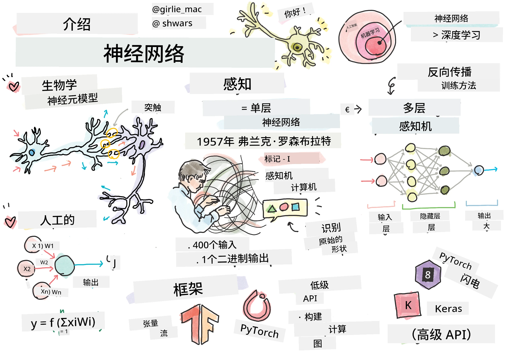
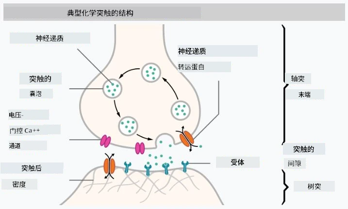

# 神经网络简介

如我们在介绍中所讨论的，实现智能的方式之一是训练一个<strong>计算机模型</strong>或<strong>人工大脑</strong>。自20世纪中叶以来，研究人员尝试了不同的数学模型，直到近年来这一路线证明非常成功。这种大脑的数学模型称为<strong>神经网络</strong>。

> 有时神经网络被称为<em>人工神经网络</em>（ANNs），以表明我们谈论的是模型，而非真实的神经元网络。

## 机器学习

神经网络是一个更大领域——<strong>机器学习</strong>的一部分，其目标是利用数据训练能够解决问题的计算机模型。机器学习构成了人工智能的大部分内容，然而，我们在本课程中不涵盖经典机器学习。

> 请访问我们单独的<strong>[初学者机器学习](http://github.com/microsoft/ml-for-beginners)</strong>课程，以了解更多经典机器学习内容。

在机器学习中，我们假设拥有一组示例数据集<strong>X</strong>，及对应的输出值<strong>Y</strong>。示例通常是由<strong>特征</strong>组成的N维向量，输出称为<strong>标签</strong>。

我们将考虑两个最常见的机器学习问题：

* <strong>分类</strong>，需要将输入对象归类到两个或更多类别中。
* <strong>回归</strong>，需要为每个输入样本预测一个数值。

> 当将输入和输出表示为张量时，输入数据集是一个大小为 M×N 的矩阵，M为样本数，N为特征数。输出标签Y是大小为M的向量。

在本课程中，我们只专注于神经网络模型。

## 神经元模型

从生物学上知道，我们的大脑由神经细胞（神经元）组成，每个神经元有多个“输入”（树突）和一个“输出”（轴突）。树突和轴突都能传导电信号，它们之间的连接称为突触，具有不同程度的传导性，这些传导性由神经递质调节。

 | 
----|----
真实神经元 *([图片](https://en.wikipedia.org/wiki/Synapse#/media/File:SynapseSchematic_lines.svg) 来源维基百科)* | 人工神经元 *(作者图片)*

因此，神经元的最简单数学模型包含若干输入 X1, ..., XN 和输出Y，以及一系列权重 W1, ..., WN。输出计算为：

其中 f 是某个非线性<strong>激活函数</strong>。

> 早期的神经元模型描述见1943年Warren McCullock和Walter Pitts的经典论文 [A logical calculus of the ideas immanent in nervous activity](https://www.cs.cmu.edu/~./epxing/Class/10715/reading/McCulloch.and.Pitts.pdf)。Donald Hebb在其著作《[行为组织：神经心理学理论](https://books.google.com/books?id=VNetYrB8EBoC)》中提出了这些网络的训练方法。

## 本章内容

本章我们将学习：
* [感知器](03-Perceptron/README.md)，最早的两类分类神经网络模型之一
* [多层网络](04-OwnFramework/README.md)，附带教学笔记本[如何构建我们自己的框架](04-OwnFramework/OwnFramework.ipynb)
* [神经网络框架](05-Frameworks/README.md)，搭配笔记本：[PyTorch](05-Frameworks/IntroPyTorch.ipynb) 和 [Keras/Tensorflow](05-Frameworks/IntroKerasTF.ipynb)
* [过拟合](../../../../lessons/3-NeuralNetworks/05-Frameworks#overfitting)

---

<!-- CO-OP TRANSLATOR DISCLAIMER START -->
**免责声明**：
本文件由 AI 翻译服务 [Co-op Translator](https://github.com/Azure/co-op-translator) 翻译完成。尽管我们力求准确，但请注意，自动翻译可能包含错误或不准确之处。原始语言版文件应视为权威来源。对于重要信息，建议使用专业人工翻译。我们对因使用本翻译而产生的任何误解或误释不承担责任。
<!-- CO-OP TRANSLATOR DISCLAIMER END -->