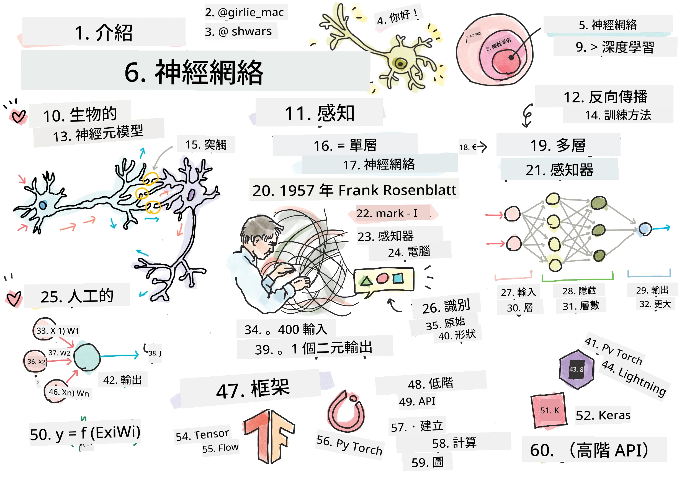
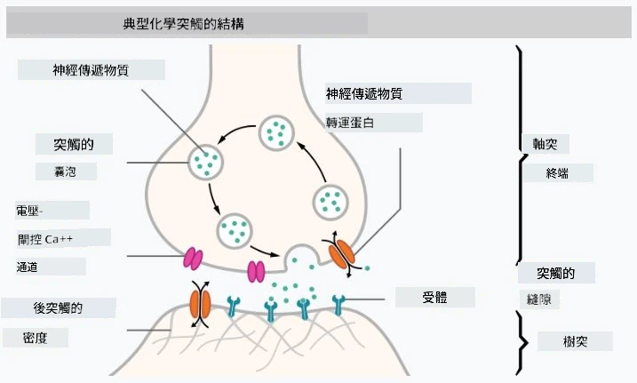
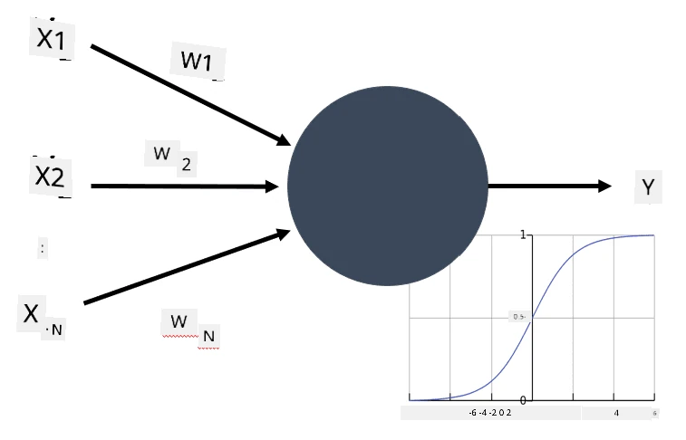

# 神經網絡簡介

如我們在簡介中討論過，要實現智能的方法之一是訓練一個<strong>電腦模型</strong>或<strong>人工大腦</strong>。自20世紀中葉起，研究人員嘗試了不同的數學模型，直到近年來這一方向證明非常成功。這些大腦的數學模型被稱為<strong>神經網絡</strong>。

> 有時神經網絡被稱為<em>人工神經網絡</em>（ANNs），以表明我們談論的是模型，而非真實的神經元網絡。

## 機器學習

神經網絡屬於一個更大的學科，即<strong>機器學習</strong>，其目標是使用數據訓練能解決問題的電腦模型。機器學習構成人工智能的重要部分，但我們在本學程中不涵蓋經典機器學習內容。

> 請參考我們獨立的 **[機器學習入門](http://github.com/microsoft/ml-for-beginners)** 課程，深入了解經典機器學習。

在機器學習中，我們假設擁有一組範例數據集 **X**，以及對應的輸出值 **Y**。範例通常是包含<strong>特徵</strong>的N維向量，輸出稱為<strong>標籤</strong>。

我們將考慮兩個最常見的機器學習問題：

* <strong>分類</strong>，需要將輸入物件分類為兩類或多類。
* <strong>回歸</strong>，需要為每個輸入樣本預測一個數值。

> 當將輸入和輸出表示為張量時，輸入數據集為一個大小為 M×N 的矩陣，其中 M 為樣本數，N 為特徵數。輸出標籤 Y 為大小為 M 的向量。

在本課程中，我們將只聚焦於神經網絡模型。

## 神經元模型

從生物學角度，我們知道大腦由神經細胞（神經元）組成，每個神經元有多個「輸入」(樹突) 和一個「輸出」(軸突)。樹突和軸突都能傳導電信號，而它們之間的連接 — 被稱為突觸 — 具備不同程度的導電性，這由神經遞質調節。

 | 
----|----
真實神經元 *([圖片](https://en.wikipedia.org/wiki/Synapse#/media/File:SynapseSchematic_lines.svg) 來自維基百科)* | 人工神經元 *(作者圖片)*

因此，神經元的最簡單數學模型包含多個輸入 X1, ..., XN 和一個輸出 Y，以及一組權重 W1, ..., WN。輸出計算如下：

其中 f 為某種非線性<strong>激活函數</strong>。

> 早期神經元模型由 Warren McCullock 和 Walter Pitts 於1943年在經典論文 [A logical calculus of the ideas immanent in nervous activity](https://www.cs.cmu.edu/~./epxing/Class/10715/reading/McCulloch.and.Pitts.pdf) 中描述。Donald Hebb 在其著作《[行為的組織：神經心理學理論](https://books.google.com/books?id=VNetYrB8EBoC)》中提出了這些網絡的訓練方法。

## 本節內容

本節我們將學習：
* [感知機](03-Perceptron/README.md)，早期用於兩類分類的神經網絡模型之一
* [多層網絡](04-OwnFramework/README.md)，以及配套筆記本 [如何建立我們自己的框架](04-OwnFramework/OwnFramework.ipynb)
* [神經網絡框架](05-Frameworks/README.md)，包括這些筆記本：[PyTorch](05-Frameworks/IntroPyTorch.ipynb) 和 [Keras/Tensorflow](05-Frameworks/IntroKerasTF.ipynb)
* [過擬合](../../../../lessons/3-NeuralNetworks/05-Frameworks#overfitting)

---

<!-- CO-OP TRANSLATOR DISCLAIMER START -->
**免責聲明**：
本文件由 AI 翻譯服務 [Co-op Translator](https://github.com/Azure/co-op-translator) 翻譯而成。雖然我們致力於確保準確性，但請注意，機器自動翻譯可能包含錯誤或不準確之處。原始文件的母語版本應被視為權威來源。對於重要資訊，建議進行專業人工翻譯。我們不對因使用本翻譯而產生的任何誤解或誤釋承擔責任。
<!-- CO-OP TRANSLATOR DISCLAIMER END -->