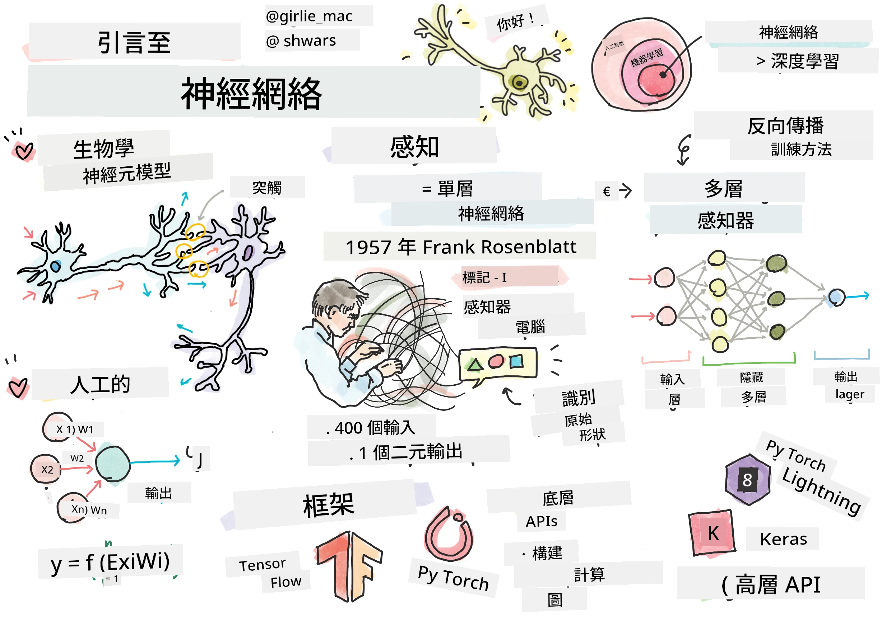
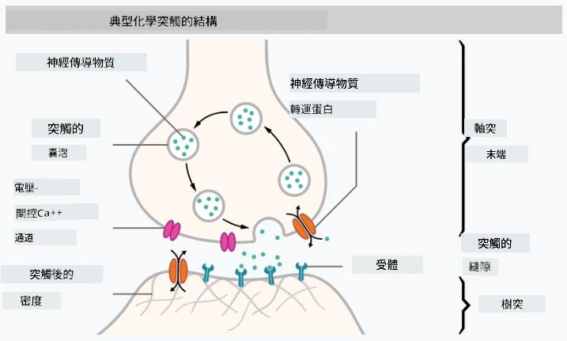

# 神經網絡簡介

如我們在介紹中所討論，實現智能的方法之一是訓練一個<strong>電腦模型</strong>或<strong>人工大腦</strong>。自20世紀中葉以來，研究人員嘗試過不同的數學模型，直到近年來這一方向證明極為成功。這種大腦的數學模型稱為<strong>神經網絡</strong>。

> 有時神經網絡被稱為<em>人工神經網絡</em>，簡稱ANN，以表明我們談論的是模型，而非真實的神經元網絡。

## 機器學習

神經網絡是更廣泛學科<strong>機器學習</strong>的一部分，該學科的目標是利用數據訓練可以解決問題的電腦模型。機器學習在人工智能中佔有重要地位，然而本課程不涵蓋經典的機器學習內容。

> 可參閱我們的獨立<strong>[機器學習入門](http://github.com/microsoft/ml-for-beginners)</strong>課程以瞭解更多關於經典機器學習的知識。

在機器學習中，我們假設有一組示例數據集<strong>X</strong>，以及對應的輸出值<strong>Y</strong>。示例通常是由<strong>特徵</strong>組成的N維向量，輸出稱為<strong>標籤</strong>。

我們將考慮兩個最常見的機器學習問題：

* <strong>分類</strong>，需要將輸入物件分配到兩個或以上的類別中。
* <strong>回歸</strong>，需要為每個輸入樣本預測一個數值。

> 當使用張量表示輸入和輸出時，輸入數據集是大小為 M&times;N 的矩陣，其中 M 是樣本數，N 是特徵數。輸出標籤 Y 是大小為 M 的向量。

本課程將專注於神經網絡模型。

## 神經元模型

從生物學角度，我們知道大腦由神經細胞（神經元）組成，每個神經元有多個「輸入」（樹突）和一個「輸出」（軸突）。樹突和軸突均可傳導電信號，它們之間的連接稱為突觸，突觸的導電性可以變化，這受到神經傳導物質的調節。

 | 
----|----
真實神經元 *([圖片](https://en.wikipedia.org/wiki/Synapse#/media/File:SynapseSchematic_lines.svg) 來自 Wikipedia)* | 人工神經元 *(作者圖片)*

因此，神經元最簡單的數學模型包含多個輸入 X1, ..., XN 和一個輸出 Y，以及一組權重 W1, ..., WN。輸出計算如下：

其中 f 是某個非線性的<strong>啟動函數</strong>。

> 早期的神經元模型由 Warren McCullock 和 Walter Pitts 於1943年在經典論文 [A logical calculus of the ideas immanent in nervous activity](https://www.cs.cmu.edu/~./epxing/Class/10715/reading/McCulloch.and.Pitts.pdf) 中描述。Donald Hebb 在其著作《[行為的組織：神經心理學理論](https://books.google.com/books?id=VNetYrB8EBoC)》中提出了這類網絡的訓練方法。

## 本節內容

本節將學習：
* [感知器](03-Perceptron/README.md)，最早的兩類分類神經網絡模型之一
* [多層網絡](04-OwnFramework/README.md)，並配有筆記本[如何構建我們自己的框架](04-OwnFramework/OwnFramework.ipynb)
* [神經網絡框架](05-Frameworks/README.md)，包含這些筆記本：[PyTorch](05-Frameworks/IntroPyTorch.ipynb) 以及 [Keras/Tensorflow](05-Frameworks/IntroKerasTF.ipynb)
* [過擬合](../../../../lessons/3-NeuralNetworks/05-Frameworks#overfitting)

---

<!-- CO-OP TRANSLATOR DISCLAIMER START -->
**免責聲明**：
本文件使用 AI 翻譯服務 [Co-op Translator](https://github.com/Azure/co-op-translator) 進行翻譯。雖然我們力求準確，但請注意，自動翻譯可能包含錯誤或不準確之處。原始文件的母語版本應被視為權威來源。對於重要資訊，建議尋求專業人工翻譯。我們不對因使用本翻譯而引起的任何誤解或曲解承擔責任。
<!-- CO-OP TRANSLATOR DISCLAIMER END -->