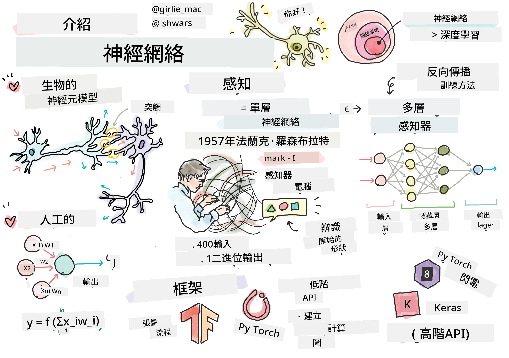
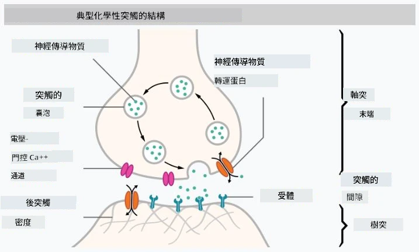

# 神經網路簡介

正如我們在介紹中討論的，實現智慧的一種方式是訓練一個<strong>電腦模型</strong>或<strong>人工大腦</strong>。自20世紀中葉以來，研究人員嘗試了不同的數學模型，直到近年這一方向證明非常成功。這些大腦的數學模型被稱為<strong>神經網路</strong>。

> 有時神經網路被稱為<em>人工神經網路</em>（ANNs），以表明我們談論的是模型，而非真實的神經元網路。

## 機器學習

神經網路是更大學科<strong>機器學習</strong>的一部分，該學科的目標是利用資料來訓練能夠解決問題的電腦模型。機器學習構成人工智慧的大部分內容，然而我們在本課程中不涵蓋經典的機器學習。

> 請參閱我們的獨立 **[機器學習入門](http://github.com/microsoft/ml-for-beginners)** 課程，以了解更多經典機器學習內容。

在機器學習中，我們假設擁有一組範例資料集 **X**，及對應的輸出值 **Y**。範例通常是由<strong>特徵</strong>組成的N維向量，輸出被稱為<strong>標籤</strong>。

我們將考慮兩種最常見的機器學習問題：

* <strong>分類</strong>，需要將一個輸入物件歸類為兩個或多個類別之一。
* <strong>回歸</strong>，需要為每個輸入樣本預測一個數值。

> 當將輸入與輸出表示為張量時，輸入資料集是一個 M×N 大小的矩陣，其中 M 是樣本數，N 是特徵數。輸出標籤 Y 是大小為 M 的向量。

在本課程中，我們僅專注於神經網路模型。

## 一個神經元模型

來自生物學方面，我們知道大腦由神經細胞（神經元）組成，每個神經元有多個「輸入」（樹突）和一個「輸出」（軸突）。樹突與軸突都能傳導電信號，它們之間的連接——稱為突觸——可以表現出不同程度的導電性，這由神經傳導物質調節。

 | 
----|----
真實神經元 *([圖片](https://en.wikipedia.org/wiki/Synapse#/media/File:SynapseSchematic_lines.svg) 來自維基百科)* | 人工神經元 *(作者圖片)*

因此，最簡單的神經元數學模型包含多個輸入 X1，...，XN 和一個輸出 Y，還有一組權重 W1，...，WN。輸出計算為：

其中 f 是某個非線性<strong>激活函數</strong>。

> 早期的神經元模型記載於 Warren McCullock 與 Walter Pitts 於 1943 年發表的經典論文 [A logical calculus of the ideas immanent in nervous activity](https://www.cs.cmu.edu/~./epxing/Class/10715/reading/McCulloch.and.Pitts.pdf)。Donald Hebb 在其著作「[行為的組織：一種神經心理學理論](https://books.google.com/books?id=VNetYrB8EBoC)」中提出這些網絡如何被訓練的方法。

## 本節內容

本節我們將學習：
* [感知器](03-Perceptron/README.md)，最早期的二分類神經網絡模型之一
* [多層網絡](04-OwnFramework/README.md) 與配套筆記本 [如何構建我們自己的框架](04-OwnFramework/OwnFramework.ipynb)
* [神經網絡框架](05-Frameworks/README.md)，包含這些筆記本：[PyTorch](05-Frameworks/IntroPyTorch.ipynb) 與 [Keras/Tensorflow](05-Frameworks/IntroKerasTF.ipynb)
* [過擬合](../../../../lessons/3-NeuralNetworks/05-Frameworks#overfitting)

---

<!-- CO-OP TRANSLATOR DISCLAIMER START -->
**免責聲明**：
此文件已使用 AI 翻譯服務 [Co-op Translator](https://github.com/Azure/co-op-translator) 進行翻譯。雖然我們努力追求準確性，但請注意自動翻譯可能包含錯誤或不準確之處。原始文件的母語版本應視為權威來源。對於關鍵資訊，建議採用專業人工翻譯。我們不對因使用此翻譯所產生的任何誤解或誤譯承擔責任。
<!-- CO-OP TRANSLATOR DISCLAIMER END -->